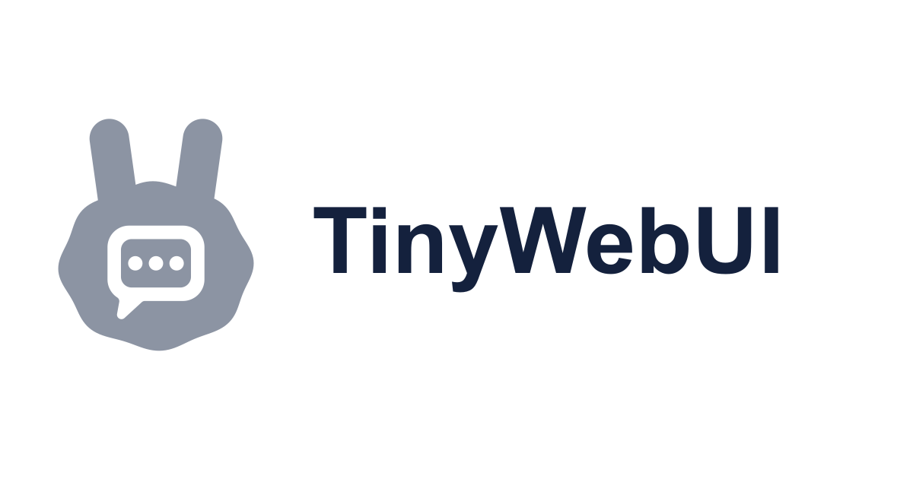

<div align="center">

# TinyWebUI

<a href="https://tinysuite.dev">
  
</a>

**A small, local-first chat workspace for any OpenAI-compatible model, with MCP tools.**

Part of [TinySuite](https://tinysuite.dev). Comes with [TinySearch](https://github.com/TinySuiteHQ/TinySearch) and [TinyContext](https://github.com/TinySuiteHQ/TinyContext) already connected.

[](https://tinysuite.dev)
[](https://www.npmjs.com/package/tinywebui)
[](https://www.npmjs.com/package/tinywebui)
[](https://github.com/TinySuiteHQ/TinyWebUI/actions/workflows/test.yml)
[](LICENSE)
[](https://nodejs.org)
[](https://github.com/TinySuiteHQ/TinyWebUI/releases)
[](https://github.com/TinySuiteHQ/TinyWebUI/commits/main)
[](https://discord.gg/mFFKF9bf5e)


<sub>From a fresh start, using DeepSeek V4.1 Flash through OpenRouter. The wait during the research turn is shown at 4× speed. <a href="docs/demo.mp4">Full-resolution video</a>.</sub>

**[Read the documentation → tinysuite.dev/docs/tinywebui](https://tinysuite.dev/docs/tinywebui/)**

</div>

---

TinyWebUI is the chat interface of [TinySuite](https://tinysuite.dev), a set of small, local-first tools for AI agents. Bring an endpoint (OpenRouter, OpenAI, Groq, Ollama, vLLM, LM Studio, or anything else that speaks the OpenAI API), pick a model and a system prompt, and start working. Chats, documents and tool output stay in one SQLite file on your machine. There is no hosted backend, no account to create, no build step and no frontend framework.

It comes pre-loaded with two TinySuite MCP servers, so a new install can already search the web and remember things:

- **[TinySearch](https://github.com/TinySuiteHQ/TinySearch)** searches, reads and reranks the web locally. It doesn't need a search API key.
- **[TinyContext](https://github.com/TinySuiteHQ/TinyContext)** is a local long-term memory that recalls only what fits the token budget.

## Highlights

- **Durable conversations.** Edit, retry, rewind, folders and full-text search. A running turn belongs to the server, so you can reload and come back to it.
- **Steer a turn while it runs.** Press Enter to reach the model at the next safe point, or Alt+Enter to hold a follow-up.
- **MCP over stdio, Streamable HTTP or SSE.** Calls that can change something wait for your approval.
- **Attachments.** Text and source files, PDFs, DOCX and images.
- **Hybrid local search** (BM25 plus a small on-device embedding model) over documents and past chats.
- **Long chats that stay affordable.** Cache-friendly prefixes, one-time compaction of large tool results, and per-round token statistics.
- **Automations.** Cron-scheduled prompts that run in a chat of your choice.
- **Private by default.** The first account becomes the administrator; later local accounts require a single-use invitation. Teams can alternatively put SSO in front.
- **Managed from files.** Version-controlled config that hot-reloads, refuses typos and has a fingerprint you can check against a running instance.
- **Themes.** Fall Fairy and Cyber Grid are included. See [theme authoring](public/themes/README.md) to write your own.

## Quick start

Requires **Node.js 22.13** or later. The bundled TinySearch and TinyContext servers also need **[uv](https://docs.astral.sh/uv/)**, which fetches them the first time they start.

```bash
npx tinywebui
```

Open <http://127.0.0.1:7777> and create the first account with a password of at least 10 characters. That account becomes the administrator and can invite others from the Admin panel. Then connect a model, in the Settings panel or in `tinywebui.config.json` (start from `example.tinywebui.config.json`):

```json
{
  "baseUrl": "https://openrouter.ai/api/v1",
  "apiKey": "${OPENROUTER_API_KEY}",
  "model": "deepseek/deepseek-v4.1-flash"
}
```

`tinywebui.config.json` describes the deployment (endpoints, connectors, models, policy) and holds no secrets. A key is either a `${NAME}` reference, filled in from the environment, or kept in `tinywebui.secrets.json` beside it: what the Settings panel saves, and the generated session-signing secret. A key written straight into the config file moves there the next time the server starts. Accounts, password hashes and conversations live in `tinywebui.db`. TinyWebUI keeps the secrets file and the database readable by their owner only; keep them private and backed up.

`npx tinywebui` uses keyword search until you run `npx tinywebui models pull fast` (about 90 MB) to enable hybrid search.

From a clone, run `npm install && npm start`. With Docker, start the service and create the administrator with an email address and password in the browser. The email is checked for valid format; TinyWebUI does not send mail or require a mail server for local accounts:

```bash
docker compose build
docker compose up -d
```

The Compose example publishes port 7777 on the host's loopback interface. Keep the data volume: it contains the accounts, conversations and local password hashes. `npm start` and `npx tinywebui` default to multiuser setup. To run a local workspace without login, explicitly set `"authMode": "local"` in `tinywebui.config.json`; this mode binds only to loopback and has full access to settings and data, without account management. The runtime images contain Node.js but no npm/npx; connect MCP servers over HTTP or include their executables in a custom image.

The former password-only `single` mode now fails startup instead of opening without login. To move such an installation to local accounts, set `authMode` to `multiuser`, restart, and create the administrator in the browser. On that first setup, existing unowned chats, files, artifacts, folders and automations move to the new administrator. Remove any `TINYWEBUI_PASSWORD` environment variable; it no longer selects an auth mode.

## Documentation

The full reference lives at **[tinysuite.dev/docs/tinywebui](https://tinysuite.dev/docs/tinywebui/)**:

| Topic | Covers |
| --- | --- |
| [Quick start](https://tinysuite.dev/docs/tinywebui/#quick-start) | npx, clone, Docker |
| [Configuration](https://tinysuite.dev/docs/tinywebui/#configuration) | Environment variables, every setting, the model catalog |
| [MCP tools](https://tinysuite.dev/docs/tinywebui/#mcp-tools) | Adding servers, tool approval, built-in tools |
| [Chats and attachments](https://tinysuite.dev/docs/tinywebui/#chats-and-attachments) | Documents, images, steering a turn |
| [Search](https://tinysuite.dev/docs/tinywebui/#search) | Hybrid retrieval, embedding models, tuning |
| [Automations](https://tinysuite.dev/docs/tinywebui/#automations) | Scheduled prompts |
| [Long chats](https://tinysuite.dev/docs/tinywebui/#long-chats-caching-and-compaction) | Caching and compaction |
| [Usage statistics](https://tinysuite.dev/docs/tinywebui/#usage-statistics) | Token use and attribution |
| [Access](https://tinysuite.dev/docs/tinywebui/#access) | Local invited users, explicit local mode, or a team behind SSO |
| [Deployment as code](https://tinysuite.dev/docs/tinywebui/#deployment-as-code) | JavaScript config, locked settings, roles and features |
| [CLI](https://tinysuite.dev/docs/tinywebui/#cli) | Every command |
| [Security and limits](https://tinysuite.dev/docs/tinywebui/#security-and-limits) | Exposure, MCP trust, what isn't included |

In this repository: [docs/deploy.md](docs/deploy.md) is a scripted container deployment, and [docs/config.schema.json](docs/config.schema.json) is the config schema (also `tinywebui schema`).

## Development

```bash
npm test        # type check, then the whole suite, about 10 seconds
npm run dev     # restart on changes in src/ and bin/
```

The server is TypeScript that Node runs directly, with no build step, so working from a clone needs Node.js 22.18 or later. The npm package ships JavaScript compiled from it (`npm run build`, which `npm pack` runs) and works from 22.13.

[AGENTS.md](AGENTS.md) maps the codebase and says where new code goes. `npm run eval` runs model-behaviour evals from `evals/tasks/` and makes real API calls, so it costs money.

## License

[GNU Affero General Public License v3.0 or later](LICENSE). If you run a modified version for users over a network, you must offer them the corresponding source code for that version.
